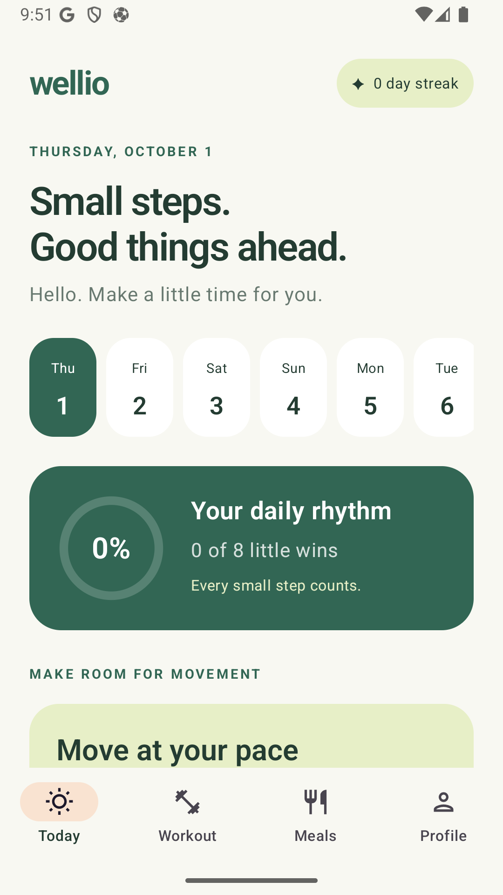
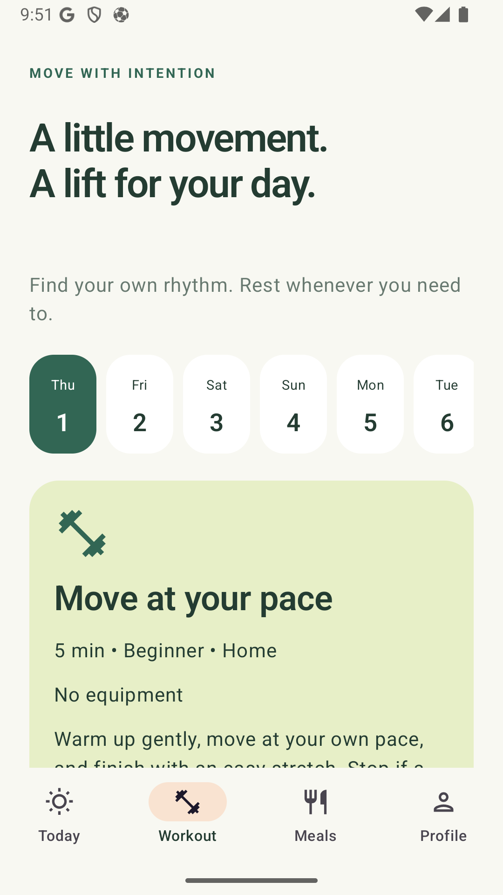
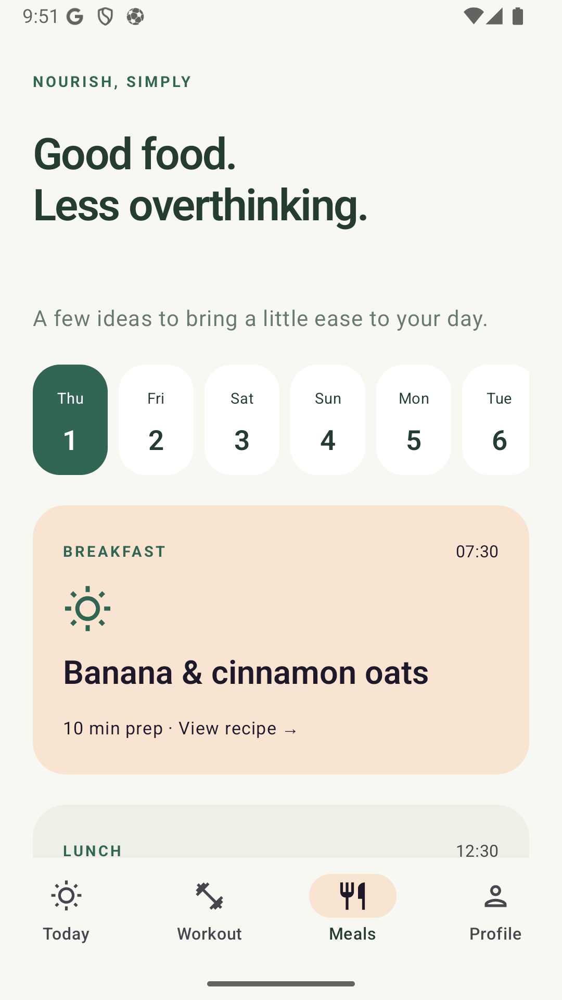
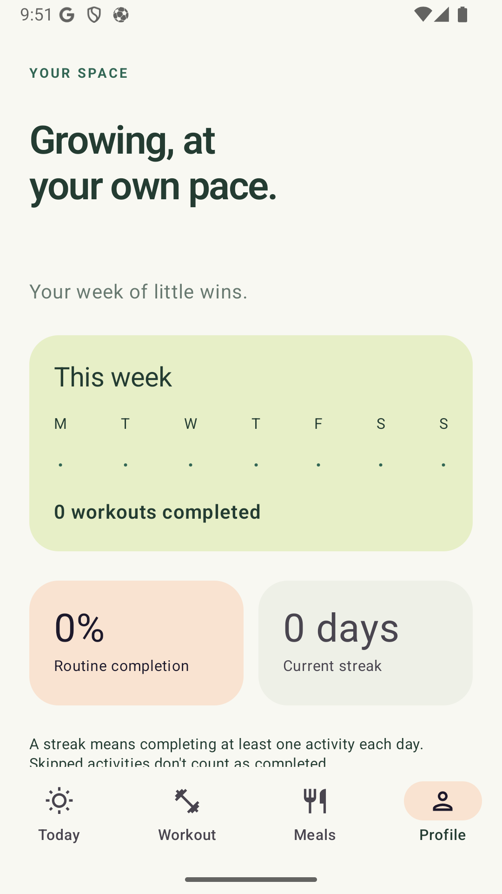
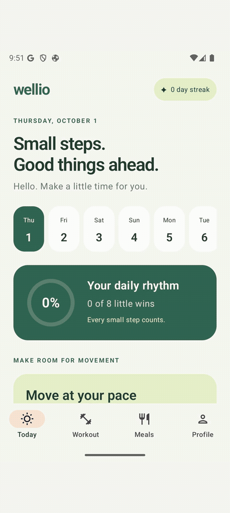

# Wellio

**An offline-first Android wellness app with optional AI-assisted planning.**

[Developer portfolio](https://mfirmansyahidris.github.io/portfolio/) · [Architecture decisions](docs/ARCHITECTURE.md) · [Validation record](docs/VALIDATION.md)

| Built with | Engineering highlights |
| --- | --- |
| Kotlin, Android, Room, WorkManager, Firebase AI Logic | On-device persistence, resumable workout sessions, reminders, validated AI responses and local fallback behavior |

Core planning works without an account or cloud AI. Explore the architecture and validation notes above for implementation decisions and recorded checks.

## Screenshots & short walkthrough

Real Android emulator captures already included in this repository.

<p align="center">
  <a href="release-assets/store-screenshots/raw/today.png"></a>
  <a href="release-assets/store-screenshots/raw/workout.png"></a>
  <a href="release-assets/store-screenshots/raw/meals.png"></a>
  <a href="release-assets/store-screenshots/raw/profile.png"></a>
</p>

**32-second screen walkthrough:** Today → Workout → Meals → Profile. Each screen is shown for eight seconds. This is a sequence of real screenshots, not a continuous interaction recording. It does not demonstrate live AI requests.

[Open the MP4 walkthrough](docs/portfolio/walkthrough.mp4)

<details>
<summary>Play the animated screen preview</summary>



</details>

## Engineering case study

**Problem:** keep a daily wellness plan useful without an account or a reliable connection, while allowing optional AI-assisted changes without losing saved progress.

**Implementation scope:** native Android UI, local planning and persistence, resumable workout state, background reminders, and an optional AI boundary.

| Decision | Why it matters | Evidence |
| --- | --- | --- |
| Room with transactional updates and Flow-backed UI | Concurrent progress updates and plan changes should preserve both operations. A versioned JSON aggregate favors atomic writes over SQL analytics in this MVP. | [Architecture](docs/ARCHITECTURE.md), [WellioStore](app/src/main/java/fi/dev/wellio/data/WellioStore.kt) |
| Local planning first; validate AI output before persistence | A timeout or malformed response must not replace a working saved plan. AI is an explicit opt-in. | [Plan validation](app/src/main/java/fi/dev/wellio/ai/PlanValidation.kt), [local planner](app/src/main/java/fi/dev/wellio/domain/LocalPlanner.kt) |
| WorkManager for reminders | Reminders can be reconciled with task status; delivery is approximate rather than an exact alarm. | [Reminder checks](app/src/androidTest/java/fi/dev/wellio/ReminderTest.kt) |
| Persist session and task state | Users can resume a workout after recreating the app instead of starting over. | [ViewModel](app/src/main/java/fi/dev/wellio/WellioViewModel.kt), [UI flow checks](app/src/androidTest/java/fi/dev/wellio/WellioFlowTest.kt) |

**Recorded validation:** the repository's [validation record](docs/VALIDATION.md) reports 14 unit tests and 4 instrumentation tests passing on October 1, 2026. Package migration and release optimization have separate checks and limits in that record. Those are historical results, not a fresh test run performed for this portfolio update.

**Trade-offs:** local data has no cloud sync; catalog coverage is intentionally limited. Live cloud-AI behavior and physical-device reminder delivery still need the checks listed in the validation record.

---


**Small steps. A healthier you.** Wellio is an Android wellness application based on the supplied product concept. It provides a daily plan, gentle movement, meal ideas, routines, reminders, and simple progress tracking.

Android application ID and namespace: `fi.dev.wellio`.

## Run the project

1. Open the `wellio` directory in Android Studio.
2. Use JDK 17 or 21, Android SDK 36, and a device or emulator running Android 8.0 (API 26) or later.
3. Allow Android Studio to create `local.properties`, then press **Run**.

From a terminal with suitable `JAVA_HOME` and `ANDROID_HOME` values:

```sh
./gradlew assembleDebug
./gradlew testDebugUnitTest lintDebug
./gradlew connectedDebugAndroidTest
```

The debug APK is generated at `app/build/outputs/apk/debug/app-debug.apk`. The Gradle Wrapper is included. Dependency versions are pinned for reproducible builds; the project does not claim to use every latest release.

Release artwork is stored in `release-assets/`. The 512 × 512 PNG is intended for the Google Play listing. Android launcher resources include adaptive and monochrome variants.

## Available features

- Short onboarding for up to two goals, activity, experience, available time, location, equipment, diet, cuisine, priorities, and foods to avoid.
- A seven-day local plan that works without an account. After installation, core planning remains available without an internet connection.
- Four primary destinations: **Today, Workout, Meals, and Profile**.
- Pending, completed, skipped, and rescheduled activity states. A task time can be changed within the selected day.
- Set-by-set workout sessions that can be paused and resumed after restarting the application. Duration is an estimate, not a stopwatch or required target.
- Targeted workout replacement by reason and single-meal replacement without changing the rest of the day.
- Simple ingredients and cooking instructions without calorie counting.
- Per-task reminders using Android notification permission and WorkManager. Delivery time is approximate. Past times do not create new reminders.
- Weekly progress, completion percentage, streak, and local history. Completing one activity keeps a daily streak; skipped activities do not add progress.
- Optional Firebase AI Logic support for seven-day plans, workout replacement, and meal replacement. Structured JSON responses are validated before storage.

## Local mode and AI mode

The application starts in **local mode**. It uses a catalog and deterministic planning rules, and the interface clearly identifies the plan source.

To connect cloud AI, follow the [Firebase setup guide](docs/FIREBASE.md). The user explicitly enables AI from Profile after reviewing what data is sent. The application never calls AI silently on launch. Errors, timeouts, and invalid output leave the saved plan unchanged.

## Data behavior

Room stores application data on the device. There is no login, cloud synchronization, advertising, or analytics. Cloud AI receives only planning preferences and the item being replaced; the user's name and completion history are excluded.

Updating the profile refreshes unfinished activities while preserving completed activities, edited schedules, and history. Missing future days are generated locally when the application opens. If the local catalog cannot satisfy a previously saved AI preference, the application repeats validated content from the latest plan and labels it **Saved plan repeat**. A new AI week is generated only after a user action.

## MVP limitations

- The local meal and workout catalogs are intentionally limited.
- Rescheduling changes the time on the selected date; it does not move a task to another date.
- Foods to avoid are preferences, not medical allergy screening. Recipes do not provide exact weights, portions, or nutritional calculations.
- Wellio is not a medical service and does not diagnose or treat health conditions.
- Wearable integration, workout video, cloud sync, and user accounts are outside this iteration.
- The generated APK is a debug build for testing and is not signed for production distribution.

## Development history

Each logical implementation stage has its own commit. Run `git log --oneline --reverse` to review the progression from foundation through models, onboarding, Today, workouts, meals, reminders, AI integration, testing, and package migration. GitHub Pages publishes only the privacy policy from `docs/privacy-policy.html`.

The local Git identity is `Wellio Project <wellio@localhost>` because no user Git identity was available when the repository was created. Change the local Git configuration before future commits if needed.

- [Product concept](docs/CONCEPT.md)
- [Architecture decisions](docs/ARCHITECTURE.md)
- [Firebase setup](docs/FIREBASE.md)
- [Validation record](docs/VALIDATION.md)

The supplied concept ended at the beginning of section 28 (`UserProfile`). Profile attributes were completed from the onboarding requirements in the preceding sections.
